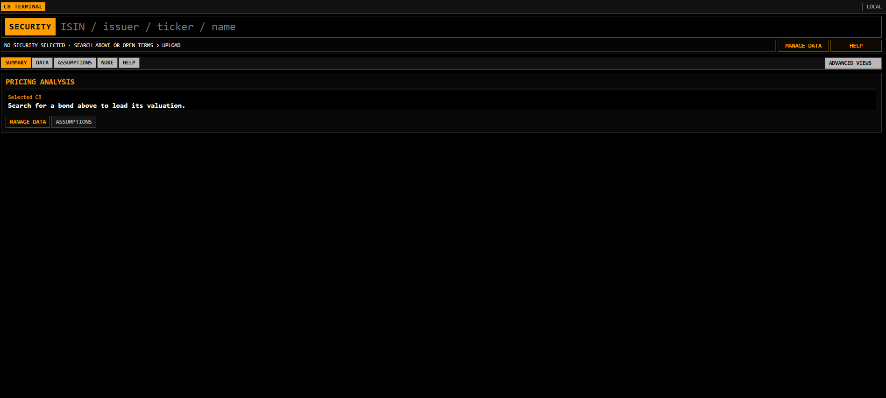

# CB Terminal

Local web application for convertible bond data intake, contract review, market-data processing, valuation, and analysis.

## Requirements

- Python 3.11+
- PyMuPDF for PDF text extraction (installed with the `prospectus` extra)
- Codex CLI signed in with your ChatGPT subscription (`codex login`); PDF extraction uses `gpt-6-sol`

## Setup

```bash
python -m venv .venv
```

Activate the environment:

```powershell
# Windows PowerShell
.venv\Scripts\Activate.ps1
```

```bash
# macOS or Linux
source .venv/bin/activate
```

Install and start the application:

```bash
python -m pip install -e ".[prospectus]"
codex login
python -m cb_terminal.cli.serve --host 127.0.0.1 --port 8000
```

Open `http://127.0.0.1:8000/`. The user guide is available at `/help`.

## Workflow

1. Upload a PDF termsheet or prospectus. Codex reads it and opens a review draft for each offered tranche.
2. Check the terms, correct any flagged gaps, and approve each bond.
3. Match the convertible bond, equity, and FX identifiers.
4. Build valuation history and review outputs and pricing scenarios.

The **PDF inbox and retry** panel appears when a document needs attention. **More PDF options** under term review contains re-extraction; saved edits remain in an unapproved draft, and approved contracts receive a separate proposal. No API key is needed. An existing `codex login` session is reused without another prompt. If Codex CLI is unavailable, intake uses the existing text parser and flags the draft for tranche and term review. If a signed-in Codex run fails, the PDF stays in the inbox with an error instead of silently switching to the parser.

## Status

Local prototype, not a trading system. `scripts/check_public_tree.py` checks that private and runtime files are not committed.

## Notes

The application uses a simplied valuation model, see [VALUATION_MODEL.md](VALUATION_MODEL.md).

## Interface


